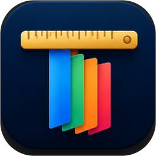

<p align="center"></p>

<h1 align="center">Themisio</h1>
<p align="center"><b>Themisio – Make your documents glow.</b></p>
<p align="center">
  Văn bản, trình chiếu, bảng tính, sơ đồ và PDF trong một ứng dụng Windows 11 viết bằng Rust.<br>
  <i>Documents, presentations, spreadsheets, diagrams and PDFs in one native Windows 11 app, written in Rust.</i>
</p>

<p align="center">
  <a href="../../releases">Tải bản mới nhất</a> ·
  <a href="CHANGELOG.md">Thay đổi</a> ·
  <a href="#english">English</a>
</p>

---

## Giới thiệu

Themisio gộp bốn ứng dụng mã nguồn mở của nhóm ArtCraft (storytold) và trình vẽ sơ đồ **draw.io** vào **một cửa sổ**:

| Trong Themisio | Dựa trên | Mở được |
|---|---|---|
| **Documents** (Văn bản) | [WordCraft](https://github.com/storytold/wordcraft) | `.docx .doc .dotx .rtf .odt .txt .md .html` |
| **Presentation** (Trình chiếu) | [DeckCraft](https://github.com/storytold/deckcraft) | `.pptx .potx .ppsx .deckcraft` |
| **CalcSheet** (Bảng tính) | [GridCraft](https://github.com/storytold/gridcraft) | `.xlsx .xlsm .xls .xlsb .ods .csv .tsv` |
| **draw.io** (Sơ đồ) | [draw.io](https://github.com/jgraph/drawio) (web app trong WebView2) | `.drawio .dio .drawio.svg .drawio.png .xml` |
| **PDF** | [PdfCraft](https://github.com/storytold/pdfcraft) | `.pdf .fdf .xfdf`, ảnh → tạo PDF |

Mỗi ứng dụng giữ **đủ tính năng và giao diện** của nó (tạo mới, mở, lưu, xuất PDF/ảnh/CSV…, in,
tự khôi phục). Themisio thêm phần dùng chung:

- **Thanh ứng dụng** bên trái: Trang chủ và năm ứng dụng. Mặc định **tự ẩn**: một đường mảnh năm
  màu (đỏ PDF, cam Trình chiếu, vàng draw.io, xanh lá CalcSheet, xanh dương Văn bản) ở mép trái báo chỗ đưa chuột vào để thanh trượt ra; nút thanh bên để giữ thanh luôn hiện.
- **Thanh tab kiểu Microsoft Edge** cho mỗi ứng dụng: mỗi tệp đang mở là một tab (bấm để chuyển,
  × hoặc chuột giữa để đóng, + để tạo mới, chấm báo chưa lưu).
- **Trang chủ**: tạo mới, mở tệp, tệp gần đây, kéo thả tệp vào bất kỳ đâu.
- **Mở đúng ứng dụng theo phần mở rộng**: `.ppsx` bắt đầu trình chiếu ngay, ảnh thành PDF,
  tệp dùng chung (`.txt .md .html .json`) hỏi mở bằng gì (có thể ghi nhớ).
- **AI, đăng nhập một lần** (Cài đặt › AI): Claude, ChatGPT, Gemini (Google AI Studio), Grok,
  Perplexity, llama.cpp, API tương thích OpenAI bất kỳ (DeepSeek, MiniMax…), hoặc **Claude Code**
  với gói Claude của bạn. Key nằm trong Windows Credential Manager.
  - **Trợ lý viết kiểu Grammarly** trong Documents, Presentation, CalcSheet: gạch chân màu theo 4
    tiêu chí (Chính xác, Rõ ràng, Cuốn hút, Truyền đạt), thẻ giải thích với Nhận / Bỏ qua / Thêm vào
    từ điển, điểm tổng 0–100, mục tiêu viết (lĩnh vực, mức trang trọng, biến thể tiếng Anh), viết
    lại / tạo nội dung / ý tưởng, báo cáo tiến bộ, kiểm tra đạo văn, tra nghĩa khi nhấp đúp. Kiểm
    tra khi gõ (tùy chọn) hoặc Ctrl+Alt+G.
  - **Dịch** chữ đang chọn (chuột phải › Dịch, Ctrl+Alt+T): Google Translate hoặc AI.
  - **Trợ lý CalcSheet**: chat ghim bên phải, trả lời theo từng token, đọc dữ liệu kèm địa chỉ ô và
    thống kê toàn bộ cột, đề xuất công thức và biểu đồ — chỉ thực hiện khi bạn cho phép, rồi tự
    kiểm tra ô lỗi.
- **Tab**: kéo thả để đổi thứ tự; chuột phải: Lưu, Lưu thành, In, Ghim tab, Đóng các tab khác / bên phải.
- **Thông báo** thành công/thất bại cho mọi thao tác.
- **Tiếng Việt và tiếng Anh** cho Themisio và cả bốn ứng dụng (Cài đặt › Ngôn ngữ).
- **Giao diện Sáng/Tối đồng bộ** cho cả bốn ứng dụng.
- **Mượt như Edge**: cuộn chuột trượt mượt, chuyển ứng dụng mờ dần, dải băng trượt nhẹ khi đổi
  tab, nút đổi màu mượt khi rê chuột, menu trượt vào chỗ. Theo cài đặt *Hiệu ứng hoạt ảnh* của
  Windows.
- **Nhẹ**: ứng dụng chỉ khởi động khi dùng lần đầu, bộ nhớ GPU cấp phát theo khối nhỏ, tự trả bộ
  nhớ cho Windows khi ở nền. Có chế độ OpenGL cho máy cần ít bộ nhớ nhất.
- **Một cửa sổ**: nhấp đúp tệp trong Explorer khi Themisio đang mở sẽ mở trong cửa sổ đó. Đóng
  cửa sổ thì từng ứng dụng hỏi về thay đổi chưa lưu của nó.

## Cài đặt

1. Tải `Themisio-<phiên bản>-win-x64.zip` trong [Releases](../../releases) (hoặc trong mục
   *Artifacts* của lần chạy mới nhất ở tab **Actions**).
2. Giải nén và chạy `Themisio-<phiên bản>.exe`. Không cần cài đặt.
3. (Tùy chọn) Cài đặt › Tệp › **Đăng ký**, rồi chọn Themisio trong *Ứng dụng mặc
   định* của Windows.

Lần đầu chạy, Windows SmartScreen có thể cảnh báo vì tệp chưa được ký số: chọn **More info ▸ Run
anyway**.

Yêu cầu: Windows 10/11 64-bit (thiết kế cho Windows 11), GPU hỗ trợ Direct3D 12 (hoặc dùng chế
độ OpenGL).

## Build từ mã nguồn

Cần [Rust](https://rustup.rs) 1.95 trở lên (toolchain MSVC và *Desktop development with C++* của
Visual Studio Build Tools) và Git.

```powershell
git clone https://github.com/nev-minhnh/Themisio
cd Themisio
powershell -ExecutionPolicy Bypass -File scripts\fetch-upstream.ps1   # tải 4 ứng dụng theo upstream.lock và áp patches/
powershell -ExecutionPolicy Bypass -File scripts\build.ps1            # build release → dist\themisio.exe
```

- `-Profile quick`: build nhanh hơn (không LTO), vẫn chạy mượt.
- `-WithCraftFonts`: nhúng thêm phông craft-fonts (tiếng Nhật/Trung, phông Latin tương thích
  PowerPoint); exe lớn thêm ~80 MB.
- `-Register`: đăng ký loại tệp sau khi build.
- Từ Linux: `scripts/fetch-upstream.sh` rồi `scripts/cross-build.sh` (MinGW-w64).

**GitHub Actions**: mỗi lần đẩy lên `main` (hoặc chạy tay *Run workflow*) sẽ build trên
`windows-latest` và đính kèm hai tệp `Themisio-<phiên bản>-win-x64.zip` và
`Themisio-<phiên bản>-source.zip`, rồi tạo (hoặc cập nhật) Release `v<phiên bản>` với hai tệp đó.

Dòng lệnh: `themisio [--app docs|slides|sheets|pdf] [--new docs|slides|sheets|pdf] [--new-window] [TỆP…]`,
`themisio --register-file-types`, `themisio --version`.

## Cấu trúc

```
Cargo.toml              workspace: crate themisio + bộ [patch] hợp nhất của bốn ứng dụng
upstream.lock           commit chính xác của từng ứng dụng
patches/                chỉnh sửa nhỏ cho các ứng dụng (bỏ Discord/kiểm tra cập nhật, một cửa sổ,
                        hiệu ứng dải băng); tạo bởi scripts/patch-upstream.py
upstream/               mã nguồn bốn ứng dụng (tải bằng scripts/fetch-upstream.*), không commit
vendor/egui/            storytold/egui 6d518fc + các bổ sung của Themisio (THEMISIO.md)
crates/themisio/src/
  main.rs               khởi động, dòng lệnh, một cửa sổ, GPU
  shell.rs              cửa sổ: thanh ứng dụng, thanh tab, trang chủ, chuyển trang, hộp thoại, luồng đóng
  rail.rs               thanh ứng dụng bên trái và các biểu tượng
  hosts/                mỗi ứng dụng được dựng như main.rs của nó
  theme.rs              màu, phông và kiểu hộp thoại của Themisio
  route.rs              loại tệp → ứng dụng → tính năng
  deck_i18n.rs, deck_vi.tsv   Presentation tiếng Việt
  i18n.rs               chuỗi giao diện của Themisio (EN/VI)
  memory.rs, gpu.rs     giảm bộ nhớ, cấu hình GPU
  assoc.rs              đăng ký loại tệp (HKCU, không cần quyền admin)
```

## Giới hạn đã biết

- Cửa sổ phụ (Presenter View khi trình chiếu) tạm ẩn khi chuyển sang ứng dụng khác và hiện lại khi
  quay về.
- Vài nhãn tiếng Việt dài trên dải băng của Presentation bị cắt bớt (nhãn có độ rộng cố định).
- Từ điển tiếng Việt của Presentation phủ các chuỗi của phiên bản trong `upstream.lock`.
- Tệp exe chưa được ký số.

## Giấy phép

Mã nguồn của Themisio được cấp phép theo **MIT** hoặc **Apache-2.0**, tùy bạn chọn
([LICENSE-MIT](LICENSE-MIT), [LICENSE-APACHE](LICENSE-APACHE)). Bốn ứng dụng nền tảng thuộc nhóm
ArtCraft và các đóng góp viên, cũng theo MIT OR Apache-2.0. Xem [NOTICE](NOTICE) và
[ATTRIBUTION.md](ATTRIBUTION.md). Tên và logo Themisio không thuộc phạm vi giấy phép mã nguồn.

Themisio không liên kết với Microsoft hay Adobe. "Word", "Excel", "PowerPoint" là thương hiệu của
Microsoft; các định dạng tệp được đọc/ghi theo đặc tả công khai (ECMA-376 / ISO 29500, ISO 32000).

---

## English

**Themisio – Make your documents glow.** One native Windows 11 app (Rust, egui, Direct3D 12) that
hosts four open-source editors from the ArtCraft team and the draw.io diagram editor side by side,
each with all of its own features: **Documents** (WordCraft), **Presentation** (DeckCraft),
**CalcSheet** (GridCraft), **draw.io** (jgraph/drawio's own web app, unchanged, in WebView2) and
**PDF** (PdfCraft).

Themisio adds an auto-hiding app bar (a thin line in the five apps' colours marks the window's edge), Edge-style
document tabs for every app, a Home page with recent files, extension-based routing (`.ppsx`
starts its slide show, pictures become PDFs, shared text formats ask once), English and Vietnamese
for every app, one light/dark theme across them, Edge-like motion (wheel smoothing, page
fades, ribbons that ease in on tab change, hover fades, gliding menus — all following Windows'
*Animation effects*), low memory use (lazy app start, small GPU allocations, working-set trimming
in the background, an OpenGL mode), single-instance file hand-off, per-user file associations, and
one close flow in which each app asks about its own unsaved work. Tabs can be dragged to reorder.

**AI, signed in once** (Claude, ChatGPT, Gemini, Grok, Perplexity, llama.cpp, any OpenAI-compatible API, or Claude Code with
your Claude plan; keys in Windows Credential Manager): a Grammarly-style writing assistant (colour-coded underlines for
correctness, clarity, engagement and delivery, an overall score, writing goals, a personal dictionary, rewrite and
generate, a progress report, an originality check, double-click definitions), translation, and a CalcSheet assistant that
streams its answers, reads every cell with its address plus whole-column statistics, and applies formulas and charts only
when you allow it — then checks the cells it wrote for errors.

**Download** the latest `Themisio-<version>-win-x64.zip` from [Releases](../../releases) or the
*Artifacts* of the latest **Actions** run, unzip and run. **Build**: `scripts\fetch-upstream.ps1`
then `scripts\build.ps1` (Rust 1.95+, MSVC). Every push to `main` builds on GitHub Actions.

Licensed under **MIT OR Apache-2.0**. The four engines are © the ArtCraft team and contributors,
also MIT OR Apache-2.0; draw.io is © JGraph Ltd, Apache-2.0; see [NOTICE](NOTICE) and [ATTRIBUTION.md](ATTRIBUTION.md).
